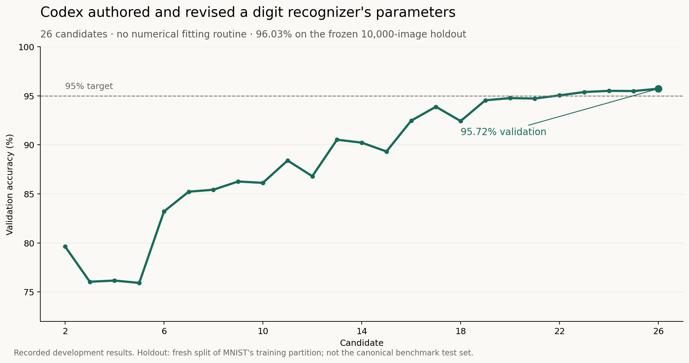

# MNIST with directly authored template parameters

**Result: 96.03%, or 9,603/10,000 correct, on a fresh withheld MNIST split.** The goal was strictly above 95%. The final candidate was `c026`; the run took about 2 hours 19 minutes.

GPT-6 Astra at Ultra reasoning used native OpenAI subagents to design and revise a numerical digit classifier. It directly authored stroke coordinates and model coefficients, then used a data-free renderer and fixed feature equations to expand them into tensors. No conventional gradient-based training or numerical fitting routine was used. Development feedback did guide its decisions, so this is not a claim that the system learned nothing from data.



## The prompt

The user asked for a new Astra Ultra thread using its own OpenAI subagents, with a persistent goal to exceed 95% on MNIST through direct model weights and no training. Iterating on numerical weights, inspecting activations, and observing evaluation feedback were expressly allowed. Claude Bridge and web search were excluded.

[The prompt](prompt.md) separates the original user request from the expanded task contract. [The sanitized transcript](transcript/coordinator.md) preserves the coordinator's visible conversation. Its [export policy](transcript/README.md) explains omitted material and redactions; it is not a raw session dump or a transcript of hidden reasoning.

## What Astra actually authored

It authored **192 generic handwriting forms** as literal stroke-coordinate arrays, stroke widths, and digit assignments. Three shared width multipliers expand them to **576 templates per view**. It also authored the normalization settings, shared feature coefficients, deformation penalties, displacement states, view weights, topology parameters, and one ten-number output-bias vector.

The saved [weight archive](model/weights.npz) is about 35 MB. Astra did not literally type every scalar in that archive. Its data-free construction code rasterizes the authored strokes, normalizes the synthetic forms, and applies the same feature equations used at inference. The resulting arrays are deterministic expansions of those authored parameters. That construction step neither computes class means nor copies dataset pixels.

This is a hand-designed template/RBF-style classifier with a fixed matching graph. It is not a conventional CNN whose dense or convolutional weight matrices were filled directly by an LLM. That distinction matters when describing the result.

## Architecture

Every input follows the same pixel-only numerical graph:

1. **Normalize.** A 28×28 grayscale image is cropped and normalized to 24×24 using fixed bounding-box and image-moment equations. Two views use deskew strengths 1 and 0.5.
2. **Extract features.** Shared operations produce brightness and oriented-edge channels. A class-independent topology branch supplies loop/closure evidence through fixed 2×2 patterns and pooling.
3. **Match deformable parts.** A 4×4 tree compares spatial parts with each template. Each part has 81 fixed integer displacement states over `[-4, 4]²`. Shared displacement and neighbor-consistency penalties permit bounded coherent deformation.
4. **Pool and classify.** Minimum-cost template matches are pooled into ten class scores, the two views are averaged, and the fixed output bias is added.

The displacement search computes inference activations. It does not revise the templates or coefficients. Inference receives only image pixels and the frozen model. Labels, sample indices, filenames, hashes, and dataset membership are absent from that interface.

## How it revised the model

The recorded process was qualitative error analysis followed by explicit authored revisions:

- **Missing handwriting styles.** After confusions involving 2 and 8, authoring agents added generic narrow-hook, short-terminal, cursive and loop variants. They documented the shapes and chose their coordinates directly.
- **Stroke-width mismatch.** Fixed shared width alternatives improved the model from 83.20% to 85.22% validation accuracy. A thinning-only attempt had reduced accuracy and was retained as a failed candidate.
- **Coherent deformation.** A tree of local parts and orientation features let related strokes move together. This was an architecture change, not a fitted parameter update.
- **Class over-acceptance.** The agent deliberately authored the fixed bias vector `[0, 0, 0, 0, 0, 0, -0.00015, 0, 0, -0.0004]` after observing excessive predictions of 6 and 9. It did not run a bias-fitting routine or sweep.
- **Alignment precision.** The final revision completed the shared 81-state displacement lattice while retaining the earlier penalties and templates. Validation increased from 95.50% for `c024` to 95.72% for `c026`; an intervening preprocessing change had not improved it.

These are recorded rationales, not access to private chain-of-thought. The complete validation history includes regressions and unsuccessful approaches. The agents acted as an outer decision-maker using labeled development feedback; “no conventional optimizer-based training” is more accurate than an unqualified “no learning.”

## Evaluation and leakage controls

The canonical MNIST training partition was freshly split into 50,000 development images and a 10,000-image primary confirmation set using seed `2026110402`. Before development, the 50,000 were divided into 35,000 working examples, 5,000 validation examples, and a further untouched 10,000-image reserve.

| Evaluation | Correct | Accuracy |
|---|---:|---:|
| Repeatedly used validation partition | 4,786/5,000 | 95.72% |
| Separate working subset | 4,814/5,000 | 96.28% |
| One-use primary confirmation | **9,603/10,000** | **96.03%** |

The confirmation result is from a fresh holdout drawn from MNIST's training partition. It is not a result on the canonical MNIST benchmark test partition. Validation was used adaptively and is development evidence.

Before confirmation, the complete model, numerical sources, preprocessing and evaluator were frozen by hash. A separate native OpenAI reviewer checked the code, data-free tensor reconstruction, prediction order/batch invariance, and frozen files. The evaluator reserved the set before opening it and released an aggregate result once. The post-run review checked counts and artifact bindings without rerunning inference.

This supports the recorded no-optimizer, no-sample-cache and withheld-confirmation account. It is not an absolute proof of no leakage: the agents shared a machine with full filesystem access, the review was performed by native agent peers, and possible MNIST exposure during LLM pretraining cannot be ruled out. The [additional trace review](TRACE_REVIEW.md) covers the coordinator and 16 descendant agents, including one qualification to a historical bias-selection timing statement. The [evidence](evidence/) preserves the historical report and review records with documented sanitization.

## Run it

From the repository root, install Python 3.12 and the pinned dependencies:

```bash
python -m pip install -r requirements.txt
python experiments/2026-11-04-mnist-direct-weights/reproduce.py verify
python experiments/2026-11-04-mnist-direct-weights/reproduce.py smoke
python -m unittest discover -s tests -v
```

Replay all 10,000 confirmation images from the checksum-verified public dataset:

```bash
python experiments/2026-11-04-mnist-direct-weights/reproduce.py replay \
  --download --output replay-output/mnist.json --expect-correct 9603
```

For an already downloaded canonical Keras MNIST archive, replace `--download` with `--data path/to/mnist.npz`. A short functional replay can use `--limit 16`; it does not substantiate the 10,000-image accuracy claim. The full replay performs no parameter updates, leaves the archived historical confirmation untouched, and may take tens of minutes on a CPU.

## What the public checks establish

The offline check verifies checkpoint/source hashes and reconstructs the saved numerical tensors from the authored sources without image data. Tests exercise synthetic inference and batch/order invariance. The separate CI replay checks the full public dataset/split/checkpoint path and requires the recorded 9,603 correct predictions.

Neither a green CI badge nor a transcript proves the complete historical absence of leakage. They let readers inspect the construction and independently run the published model. The original confirmation remains a historical one-use event; every public rerun is labeled a replay of the now-exposed split.

The first [hosted replay](https://github.com/EvanOman/agent-experiment-records/actions/runs/41966207607) passed with exactly **9,603/10,000**. Its [aggregate output](../../ci-proofs/mnist-c026-replay.json) and [run/commit record](../../ci-proofs/mnist-c026-run.json) are saved in this repository. Those records identify the tested source commit; later documentation/proof additions do not alter the numerical model or replay code.
